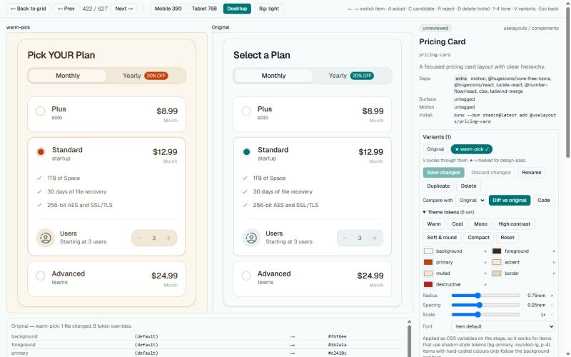
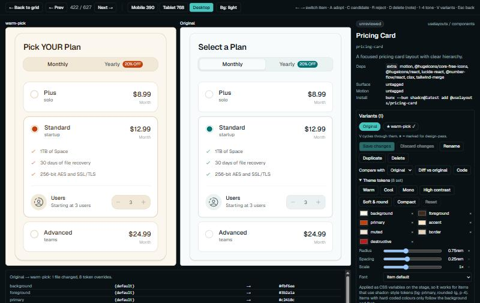
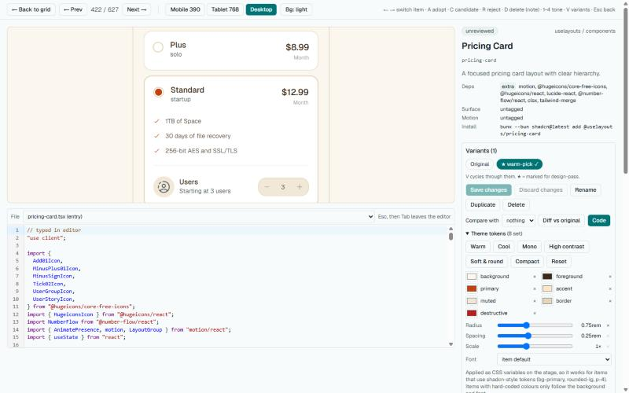

# UI gallery

A separate small Vite + React + Tailwind app for browsing the `ui-component-catalog` visually and picking components by hand. It has its own `package.json`; the main `sandbox/` app is untouched (its bundle size is the baseline for skill trials). It reuses the sandbox design tokens (`../src/polished/*.css`) and nothing else. Never shipped.

## Run

```bash
cd sandbox/gallery
npm install
npm run gallery:fetch               # the 82-item proof set (re-run fetches only what is missing; --force refetches)
npm run gallery:fetch -- --all     # all 754 items; add --install to npm-install the packages they ask for
npm run gallery                    # http://localhost:5174 (npm run gallery -- --port N for another port)
```

Both scripts also work from the repo root. `vite.config.ts` scans `src/items/` and pre-bundles the heavy packages up front; without that Vite discovers them one at a time, reloading the page each time, and previews stay on `loading…`. After a fresh fetch of new items, restart the dev server so the scan sees them.

`?need=<term>` seeds the search box (`design-pass` will link here later).

## Fetching

`gallery:fetch` downloads each item's source from its registry (uselayouts, ui-layouts, beui, React Bits) into the gitignored `src/items/`. It is resumable (status is flushed every 25 items; registry JSON is cached in `.fetch-cache/`), runs 4 requests at a time with a 150 ms pause per worker, never fetches tombstoned items, and ends with a summary: fetched, already on disk, skipped tombstoned, failed, with the failures grouped by cause. Items whose imports cannot be resolved (a package that is not installed, a sibling file the registry does not ship, an `@/…` module the gallery lacks) are not written: they show **won't render** with the reason instead of breaking the build. After fetching it runs `vite build` and drops any item whose imports the build rejects (a package lacking a named export, a type imported as a value), repeating until the build passes (`--no-check` skips). `--install` installs the missing packages into this gallery's own `package.json` (never `sandbox/`'s), with `--ignore-scripts`, and retries those items. `next/image`, `next/link` and `@repo/shadcn` are answered by shims in `src/shims/`.

## What is shown

All 754 catalog items, with status tags. By default only **unreviewed** and **candidate** show; the other statuses (used, adopted, rejected, deleted) are chips you switch on. Items not fetched yet show **not fetched**. The grid is windowed (only the rows near the viewport mount), the sidebar lists sources and families with counts, search covers title, key, description, family, catalog notes and your notes, and sort is by name, status or ranking. Every filter, the sort and the preview background are saved in this browser (localStorage); **Reset filters** clears them.

Each card renders the real component, lazily, inside an error boundary, only while it is near the viewport (many WebGL canvases at once exhaust browser contexts). Items that fail to download or render get a **won't render** tag with the error. A card shows the preview (with the ranking score in its corner, only when the item is ranked), the title and source, one chip line (Tone, up to two Roles, status once reviewed) and a dot when the item adds an npm package (`extra` = e.g. motion or icons, `heavy` = gsap/ogl/three/matter-js/lenis). Key, description, catalog notes, your note and the score reason are on the detail page. **Adopt / Candidate / Reject / Delete** appear on hover or keyboard focus; with a card focused, **A / C / R / D** act on it. Tick a card's corner box to select it for the bulk bar.

The header always shows search, Status, Tone, Role and Sort. **Filters** holds Surface, Deps, Fetch and Min score (the button shows how many differ from the default). The data path and the saved-filters note sit in the page footer.

Each preview sits on a sized stage (about 460 px wide, 24 rem tall). **Previews: auto/light/dark** in the header sets every stage: `auto` is white, except `backgrounds` items (additive WebGL light, invisible on white) get a dark stage. **Bg** on a card flips just that one. Cards show a state: `loading…` (after 15 s `still loading…` with a retry), `renders blank` (nothing visible after load: no text, media, painted box or canvas pixels; WebGL canvases count as content because their pixels can't be sampled between frames; checked for ~12 s since shaders start late), `won't render` plus the error, or nothing when it rendered. Fetch failures and unresolvable imports also show as `won't render`. Animated canvases can flag blank while the browser tab is in the background, because requestAnimationFrame is paused.

## Detail page

The title, preview or **Open** button on a card opens `#/item/<source>/<key>` (links work directly, `?need=` still applies). It shows one live preview filling the page, a width switcher (Mobile 390 / Tablet 768 / Desktop; the preview is a fixed-width box, so CSS media queries still follow the browser window, not that box), the light/dark stage toggle, score and reason, Tone and Roles (with **Accept suggestion** when `/gallery-rank` proposed some), status, package cost, deps and install command, Adopt/Candidate/Reject/Delete with note, and fetch details (open when fetching failed). **← Prev / Next →** or the arrow keys follow the grid's current filter and sort; **Esc** or **Back to grid** returns with filters and scroll position kept (the grid stays mounted, hidden). Only the on-screen item renders, so a heavy WebGL item gets the whole stage.

Rendering is a gallery, not a faithful install: items that need props to show anything get them from `demo-props.json` (keyed by catalog id; `_children` becomes simple child divs). Add an entry when a card is blank or throws on undefined props. `scripts/demo-guess.mjs <probe.jsonl>` bulk-adds entries for everything a `scripts/shots.mjs --probe` run found blank or failing, by reading each component's required props (arrays become sample rows, strings, numbers, children); it never changes an existing entry. Registry `css` (keyframes) is written to `src/items/_items.css`; Tailwind config extensions and `registryDependencies` other than the shadcn basics in `src/components/ui/` are not resolved.

## Review queue

**Review queue** in the header steps through the unreviewed and candidate items (within the current search and sidebar choice, in the current sort) one at a time on the detail page. Keys: **A** adopt, **C** candidate, **R** reject, **D** delete (puts the cursor in the note; type the reason, Enter confirms), **← →** move, **Esc** leaves. Any decision moves on to the next item. The queue is a snapshot taken when it opens; an item you decide is removed from it once you move on (the last one stays until you leave it). The same keys work on a normal detail page.

## Reporting components that don't load

**Report** (card on hover, next to Adopt / Candidate / Reject / Delete; detail page, next to the pick buttons) opens a small picker: an optional one-line note, then one click on the symptom: Blank, Stuck loading, Error shown, Looks wrong, Other. In the review queue **B** reports the item with the symptom its preview shows (error, blank, stuck loading, else Other) and moves to the next one. A report records the item id and source, symptom and note, how the preview looked (`state`), the preview width (the card's, or the detail page's width switcher), the stage and page background (light or dark), the last five console errors, the time and the gallery version (`package.json`).

Reports are written to `reports.json` in the data dir (see below), with the same safe write and timestamped backups as `picks.json`; never into the repo. An item that was still unreviewed counts as **reported**: it gets its own Status chip, leaves the unreviewed pool and the review queue (once you move off it), and is hidden from the default view and from *only no status*. An item that already has a status keeps it and stays where it was. While a report is open the card and the detail page show a **Reported** chip with **undo** (drops the latest report); the detail page also has **Fixed**. The Filters popover has a **Reported** chip that shows only items with an open report, whatever their status. A second report on a still-reported item adds another entry, so the history is kept. **Fixed**, or a re-render that succeeds after the item was reported while it was not rendering, closes the open reports; the item can then be reported again.

`/gallery-fix` (project skill in `.claude/skills/gallery-fix/`, invoke-only, not shipped) works through the open reports: it tries to repair each item (a `demo-props.json` entry via `scripts/demo-guess.mjs`, import or shim fixes, a re-fetch), re-renders it with `scripts/shots.mjs --probe`, then marks the report fixed or marks the item won't render with a reason. It uses Sonnet sub-agents, one per item.

## Ranking (`/gallery-rank`)

`/gallery-rank <family|source|all> [--limit N] [--resume] [--force]` (project skill in `.claude/skills/gallery-rank/`) screenshots each item on a light and a dark stage with the system Chrome or Edge (`scripts/shots.mjs`, via `playwright-core`; no browser is downloaded), has Sonnet sub-agents score it 1 to 5 on app fit, accessibility and reduced motion, dependency cost, visual polish and uniqueness, and writes `ranking.json` (`{id, score, scores, reason, blank}`). Cards and the detail page show the score and reason; the grid sorts by it and filters by **Min score**. **Accept hint** sets a pick from the score (4 or more: Candidate; 2.5 or less or blank: Reject); you can also ignore it. Picks always win and the ranking never writes to `picks.json`. `scripts/shots.mjs --probe <ids>` only reports how each item renders.

## Picks

Each item has **Adopt / Candidate / Reject / Delete** (on the card on hover, or on the detail page) and a note. The Vite dev server writes them to the shared data dir (below), never into the repo or the plugin files. Clicking the active button clears it. **Delete** is a permanent tombstone (`status: "deleted"` plus `reason`, taken from the note, which is required): `gallery:fetch` skips tombstoned items and removes their downloaded folder. Deleted items are hidden by default (status chip). **Export picks** downloads the same JSON.

Applying picks to `curated.json`, refreshing and releasing is a separate step.

### What `refresh.mjs` must do later

`scripts/refresh.mjs` rebuilds `components.json` from the registries, so a deleted item would come back as `unreviewed`. When picks are applied it must read the tombstones (from `curated.json`, e.g. `"status": "deleted"`) and drop those ids from `out`, keeping them in a `deleted` list in `curated.json` so the next import skips them too.

## Choose components (`design-pass` handoff)

`design-pass` can ask you to pick components before it builds ("Pick components in the gallery?"). Setup: set `UI_GALLERY_DIR` to this checkout's `sandbox/gallery` (design-pass starts `npm run gallery` from there, port 5174).

| Route | What it shows |
|---|---|
| `#/select/<run-id>` | One row per need: the suggested default (pre-selected), up to four alternatives, and a **None / plain shadcn** tile. Shared needs (the app kit) come first, then each page's needs, then an **Extras** strip (tick to use). **Done** writes your choices. Items that add an npm package are hidden in Safe mode behind **Show items that add a package**; picking one lists the package in a banner and counts as your yes to install it. |
| `#/review/<run-id>` | After the build: each used item next to its alternatives. Click an alternative to mark a swap, **Save swaps** writes them. Applying swaps is a normal design-pass run on that screen with the swap list. |

Files, all in `<data dir>/runs/` (see "Where your data lives"): `<run-id>.json` (design-pass: needs and shortlist), `<run-id>.selection.json` (Done), `<run-id>.result.json` (design-pass after the build: what was used), `<run-id>.swaps.json` (review), `kit-<project>.json` (shared choices that later runs of the same project reuse without asking). Say "done" in chat after pressing Done; design-pass reads the file, nothing polls. The shortlist script is `plugins/design-stack/skills/design-pass/scripts/shortlist.mjs`; with `UI_GALLERY_DIR` set it also skips items that failed to fetch or render. Used items get status `used` in `picks.json`.


## Gitignored, and why

- `src/items/`: downloaded third-party source and `_status.json`. The repo is public and React Bits is MIT + Commons Clause, so its source must never be committed.
- `.fetch-cache/`: cached registry JSON (the same third-party source).
- `.rank-shots/`, `.rank-batches/`: ranking screenshots and scratch batches.
- `src/work/`: working copies of variants (modified third-party source, see Variants).
- `node_modules/`, `dist/`.

## Where your data lives

Picks (status, notes, categories) and the `/gallery-rank` scores are the work you can't cheaply redo, so they live outside any worktree:

| File | What |
|---|---|
| ~/.claude/ui-gallery/picks.json | picks and category assignments (under your user profile on Windows) |
| ~/.claude/ui-gallery/variants/ | your saved variants (`<source>/<key>/<name>/`), see Variants |
| ~/.claude/ui-gallery/settings.json | the remembered export target project and the last few used |
| `~/.claude/ui-gallery/ranking.json` | `/gallery-rank` scores and suggestions (they cost tokens to regenerate) |
| `~/.claude/ui-gallery/reports.json` | Report button entries (`{reports: [...]}`, each with `status`: open, fixed, wontrender or undone) |
| `~/.claude/ui-gallery/backups/` | the last 20 timestamped copies of each file, at most one a minute |

- Override the folder with the env var `UI_GALLERY_DATA_DIR`. The gallery shows the path in the page footer. Export picks still downloads a copy.
- Writes go to a temp file and are renamed into place, so a crash can't leave a half-written file.
- One-time import: on start, the old in-repo `picks.json` and the committed `ranking.json` are imported if the shared files are missing or lack their ids. Where both have the same pick, the newer `at` wins; the gallery says what happened until you dismiss it. Each old file is imported once (its hash goes in `migrated.json`), so a pick you later remove is not brought back.
- `picks.json` in the repo is gitignored and no longer tracked. The committed `ranking.json` stays as the seed from the proof run; the live one is the shared file.
- Committed definitions stay in the repo: `categories.json`, `demo-props.json`.

## Categories

`categories.json` (committed) holds two groups the user edits on the **Categories** screen (`#/categories`): **Tone** (one per item, four values) and **Role** (several). The default Roles are Navigation, Forms and inputs, Data and feedback, Layout and overlays, Effects and backgrounds, and Full sections. Keep each group to at most 8 values; there is no Style group and no free-text tags. Each value has a stable `id`, a `label` and its place in the list is its order. A Tone value may carry `surface` (`app` or `marketing`, which overrides the item's own surface tag in the Surface filter) and a `rule` (Showpiece / silly: never in Safe mode, Free mode only on request).

- Assignments live in the shared `picks.json` next to status: `tone`, `roles[]`. The ranking never writes them.
- Old data is migrated on read: roles from the previous list map to the new ids, `styles` are dropped, and an entry that held only styles is removed. A backup is forced first (the one-a-minute limit does not apply). Role ids you added yourself are kept.
- Removing a value that items still use asks first. Those items keep the id and show it flagged "removed" until unassigned.
- Assign on the detail page with the four Tone buttons (keys **1-4** in the detail page and review queue, press again to clear; A/C/R/D still set the status and advance) and the Role dropdown (several, shown as chips). In bulk, tick cards in the grid and use the same two controls in the bar that appears (a bulk Role adds, it never removes).
- Filter by any value (several in one group = any of them), or by **Uncategorized** (no Tone and no Role). Counts show per value; filters are saved in localStorage. Export picks includes the category lists.
- `/gallery-rank` also writes `suggested: { tone, roles[], reason }` into the shared `ranking.json`. The detail page shows one **Accept suggestion** button that sets the Tone and Roles together; it is hidden when there is no suggestion or the item already matches it.

## Variants (local component editor)

On a detail page you can tweak an item and keep the result as a named **variant**. The original in `src/items/` is never written; **Edit a copy** starts a **Draft**, a working copy.

- **Code**: a CodeMirror 6 panel (the gallery's own dependency) edits every source file of the copy. Edits are written through the dev server after 350 ms and Vite HMR reloads the preview. Esc, then Tab leaves the editor.
- **Describe the change**: a text box that builds a prompt with the copy's file paths, your instruction and the repo rules. **Copy prompt** puts it on the clipboard; the page never launches Claude or any CLI.
- **Save**: *Save as variant…* names it (letters, digits, `. _ -`). Saved variants can be renamed, duplicated and deleted (deleted ones move to `variants/.trash/`, nothing is erased) and can change in place (*Save changes* / *Discard changes*).
- **Compare**: the variants row switches the preview between Original, the Draft and each variant (key **V** cycles). *Compare with* shows two side by side. *Diff vs original* shows a line diff per changed file.
- **Picks**: a variant has its own adopt / candidate / reject, note and Tone / Roles, stored in `picks.json` under `<source>/<key>#<variant>`. **Mark for design-pass** sets `preferredVariant` on the item's pick (design-pass reads it in a later change).

### Where variants live

`<data dir>/variants/<source>/<key>/<name>/` holds `files/` (the full file tree of the item, edited) and `meta.json` (parent id, created, updated, note, entry). Never in the repo, so a clean worktree keeps them. Vite cannot resolve npm packages for files outside the project root, so rendering uses a gitignored working copy at `src/work/<source>/<key>/<slot>/` (`_draft` or the variant name). It is imported by URL (`/src/work/...`), which gives HMR and finds files created while the server runs. *Save* copies the working copy into the data dir; opening a variant on a fresh checkout copies it back. `src/work/` is a scratch folder you can delete: unsaved drafts go with it.

### Exports (on a saved variant)

- **Copy into a project…**: enter a project folder (remembered in `settings.json`, with the last few). If it has a `components.json`, the files go to `<aliases.components>/<key>-<variant>/` (aliases resolved through `tsconfig.json` / `jsconfig.json` `paths`, else `src/`); otherwise you type a destination. The dialog lists each file as new, identical or *exists, differs*. For differing files it shows a diff and a per-file **Overwrite** checkbox; the server refuses to overwrite a file that is not ticked. It never runs npm: it shows the install command (npm, pnpm, yarn or bun by the project's lockfile) with a copy button, the `npx shadcn@latest add` line for shadcn components the files import, and a minimal usage snippet.
- **Copy install prompt**: a prompt for Claude to install the variant into a project: variant folder, deps, usage, and the "diff and ask before overwriting" rule.
- **Mark for design-pass**: see Picks above.

### Licence

React Bits is MIT + Commons Clause, so modified third-party source must stay out of this public repo. Variants and working copies live outside git (`<data dir>/variants/`, gitignored `src/work/`), and the prompts say so. Before committing anything, `git status` must show no `src/items/`, `src/work/` or variant files. Copying a variant into your own project is a separate decision under each item's licence.




